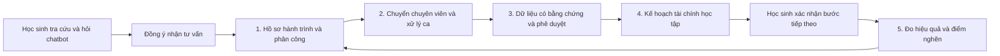

# Đánh giá dự án Trovio và đề xuất 5 chức năng doanh nghiệp

Ngày lập: **20/11/2026**, giờ Việt Nam. Đối tượng đọc: chủ sản phẩm, trưởng kỹ thuật và đội vận hành tuyển sinh.

> Báo cáo dưới đây mô tả trạng thái trước đợt sửa. Xem [kết quả sửa kỹ thuật ngày 20/11/2026](technical-fixes-2026-11-20.md) để biết thay đổi đã thực hiện, kiểm chứng và các phần nghiệp vụ được giữ nguyên.

## 1. Kết luận dành cho người ra quyết định

Trovio có nền tảng nghiệp vụ tốt để phát triển thành sản phẩm tư vấn tuyển sinh: tra cứu trường/ngành/chương trình, hồ sơ điểm, RIASEC, gợi ý có giải thích, nguyện vọng, chatbot, nhập dữ liệu và quản trị. Điểm yếu lớn hiện tại là **độ tin cậy khi vận hành và khả năng biến hành vi sử dụng thành kết quả nghiệp vụ đo được**.

Ưu tiên trước khi mở rộng: xử lý dependency có cảnh báo, ngăn mất dữ liệu khi đồng bộ và lưu hội thoại, đưa test vào CI, làm rõ ý nghĩa thống kê và bảo vệ các biên hạ tầng. Chưa nên quảng bá thống kê hiện tại là số người quan tâm, lịch sử trọn đời hay xác suất trúng tuyển.

Đề xuất phát triển một sản phẩm nhất quán: **nền tảng quản lý hành trình tư vấn tuyển sinh có bằng chứng**, dành cho đơn vị tư vấn/trung tâm tuyển sinh. Năm chức năng ở phần 6 cùng phục vụ bài toán này, có thể triển khai từng phần trong kiến trúc monolith hiện có.

## 2. Phạm vi và phương pháp

### Phạm vi thực tế

- Kiểm kê và quét cấu trúc **444 file, 49.558 dòng** thuộc `src`, `database`, `scripts`, `docs`, `.github`; trong đó có **365 file ứng dụng, 78 API route và 29 file test** tại thời điểm kiểm kê. Đây là số liệu của tập file văn bản được chọn, không phải mọi file trong ổ đĩa.
- Đọc sâu các luồng xác thực/phiên, quản trị, lưu và gộp dữ liệu tài khoản, chatbot/AI/ảnh/quota/lịch sử, thanh toán, nhập dữ liệu, gợi ý, thống kê, truy cập PostgreSQL và CI. Đối chiếu README, tài liệu kiến trúc, migrations và các báo cáo vận hành sẵn có.
- Không coi việc quét toàn repository là đã kiểm chứng từng dòng dữ liệu tuyển sinh hay đã kiểm thử mọi giao diện. Không đọc nội dung bí mật trong `.env.local` để đưa vào báo cáo; không trích email cá nhân, token hay mã băm mật khẩu.
- Không sửa chức năng ứng dụng trong đợt phân tích này. Những thay đổi chatbot từ yêu cầu trước vẫn thuộc trạng thái mã đang được đánh giá.

### Phương pháp chuyên môn và skill

Bộ skill cài sẵn không có skill chuyên kiểm toán mã nguồn hoặc phân tích nghiệp vụ. Đã kiểm tra phạm vi skill visualization: yêu cầu tạo file Markdown độc lập không thuộc luồng visualization trong hội thoại, nên không áp dụng ép buộc. Báo cáo sử dụng trực tiếp: lập bản đồ kiến trúc, rà soát ranh giới tin cậy, kiểm chứng đường đi dữ liệu, kiểm tra dependency, thử nghiệm tái hiện nhỏ và thiết kế yêu cầu theo bài toán–quy trình–KPI–nghiệm thu.

Tiêu chí bảo mật tham chiếu [OWASP ASVS](https://github.com/OWASP/ASVS). Đây là rà soát kỹ thuật có định hướng ASVS, **không phải chứng nhận ASVS hoặc pentest đầy đủ**. Hướng dẫn xác thực máy chủ database đối chiếu [tài liệu PostgreSQL về SSL](https://www.postgresql.org/docs/current/libpq-ssl.html).

### Kết quả kiểm chứng

| Hạng mục | Kết quả quan sát được | Giới hạn kết luận |
|---|---|---|
| `npm run check` | TypeScript ứng dụng và database đạt; **114/114 test đạt**; secret check đạt trên **483 tracked files** | Không chứng minh mọi luồng UI, dữ liệu thật hoặc tích hợp bên ngoài đúng |
| `npm audit --omit=dev --json` | **8 package có cảnh báo**: 1 critical, 5 high, 2 moderate | Đếm package trong báo cáo npm, không phải 8 lỗ hổng độc lập có thể khai thác trong ứng dụng |
| Kiểm tra dependency cài đặt | Next **16.3.6**, Firebase **13.4.0**, ExcelJS **4.4.0**; có dependency gián tiếp bị cảnh báo | Cần phân tích đường gọi và cấu hình trước khi xác định khả năng khai thác |
| Tái hiện giới hạn JSON | Đặt giới hạn 10 byte, stream thử nghiệm 500 byte: hàm vẫn đọc đủ **500 byte** rồi mới từ chối | Thử nghiệm nhỏ xác nhận thứ tự xử lý, không phải thử tấn công tải lớn |
| Tái hiện adapter rate limit async | `hit()` async làm `rateLimit()` trả **Promise** dù kiểu khai báo là `number` | Memory adapter hiện tại đồng bộ; lỗi lộ ra khi thay bằng adapter bất đồng bộ |
| Tổng kết chatbot theo user | Truy vấn user có dữ liệu và user không tồn tại chạy được; đối chiếu số hội thoại phù hợp | Chưa chứng minh giữ đủ lịch sử vì cơ chế lưu có cắt tin nhắn |
| Build production, E2E, tải, giao dịch thật | **Không chạy mới trong đợt này** | Không dùng báo cáo ngày trước làm bằng chứng hiện tại |

## 3. Những phần đang làm tốt

1. **Kiến trúc phù hợp quy mô hiện tại.** Modular monolith Next.js → services → repositories → PostgreSQL dễ vận hành hơn tách microservice sớm. Hợp đồng repository và domain giúp kiểm thử nghiệp vụ độc lập.
2. **Xác thực đã có các lớp bảo vệ thực chất.** Mật khẩu scrypt, cookie HTTP-only, chữ ký HMAC, phiên bản phiên để thu hồi, kiểm tra quyền admin, khóa sau đăng nhập sai và kiểm tra nguồn gốc request ghi. Không nên thay tất cả chỉ để dùng một thư viện mới.
3. **Nghiệp vụ gợi ý có giải thích.** `recommendation.service.ts` trình bày tiêu chí, trọng số, dữ liệu thiếu và độ bao phủ; phù hợp bài toán hỗ trợ quyết định hơn đưa một điểm AI không giải trình.
4. **Đã đầu tư độ tin cậy dữ liệu tuyển sinh.** Có nguồn/ngày đối chiếu, trạng thái xác nhận, dữ liệu theo năm, nhập CSV/XLSX và transaction. `data-trust.service.ts`, `admission-policy.service.ts` là nền tảng nên giữ.
5. **Chatbot không chỉ là một request gọi model.** Có FAQ, dữ liệu nội bộ, kiểm soát nguồn, kiểm tra link, xử lý ảnh và quota PostgreSQL. Quota nghiệp vụ này khác với rate limit IP trong bộ nhớ.
6. **Thanh toán có đối soát phía server.** Có kiểm tra callback/webhook, số tiền, mã giao dịch, xử lý trạng thái và test hồi quy. Chưa thấy bằng chứng đủ để kết luận đã vận hành thanh toán thật ổn định.

## 4. Điểm yếu và việc cần sửa

Mức ưu tiên: **P0** cần xử lý trước khi mở dịch vụ công khai rộng; **P1** ảnh hưởng dữ liệu/độ ổn định, làm trong đợt kế tiếp; **P2** cải tiến khả năng mở rộng và bảo trì. Mức này là ưu tiên của dự án, không thay thế CVSS.

### F01 — Dependency đang cài nằm trong các cảnh báo bảo mật [P0, đã xác nhận từ registry]

**Bằng chứng:** `package-lock.json`, kết quả `npm audit` và `npm ls`. Nhóm package bị báo gồm `next`, `firebase`, `@firebase/firestore`, `@firebase/firestore-compat`, `@grpc/grpc-js`, `source-map-js`, `exceljs`, `uuid`.

Đã kiểm tra trực tiếp [GHSA-2464-fhr4-w9xw](https://github.com/advisories/GHSA-2464-fhr4-w9xw): advisory ghi nhánh Next từ 16.0.0 đến 16.4.0 bị ảnh hưởng, bản vá đầu tiên 16.4.1; phiên bản đang cài là 16.3.6. Advisory này liên quan Image Optimization và SVG. **Chưa tái hiện khai thác và chưa xác nhận cấu hình hiện tại đáp ứng điều kiện tấn công.** Có nhiều advisory khác trong kết quả audit, nên 16.4.1 không được mặc định là bản đích đủ để giải quyết tất cả.

**Sửa:** lập PR nâng phiên bản được hỗ trợ và đã vá toàn bộ advisory liên quan tại thời điểm triển khai; kiểm tra thay đổi Next/Firebase, chạy test, build và smoke. Không chạy `npm audit fix --force` mù quáng: báo cáo hiện gợi ý cả việc hạ Firebase/ExcelJS qua major, có thể phá chức năng.

**Nghiệm thu:** dependency tree không còn advisory nghiêm trọng chưa có phương án; từng ngoại lệ có lý do không ảnh hưởng, người chịu trách nhiệm và thời hạn xử lý.

### F02 — Giới hạn JSON chỉ kiểm tra sau khi đọc toàn bộ body [P1, đã tái hiện]

**Bằng chứng:** `src/lib/http.ts:12` dùng `await req.text()` rồi dòng 13 mới so byte; kiểm tra `Content-Length` trước đó không đủ với request thiếu header hoặc truyền dạng stream. Thử nghiệm 10 byte/500 byte xác nhận đọc quá giới hạn trước khi trả lỗi.

**Tác động:** request lớn vẫn có thể tốn RAM/CPU trước khi bị từ chối. Khả năng tấn công thực tế phụ thuộc giới hạn của CDN/reverse proxy và runtime.

**Sửa:** đọc stream có bộ đếm byte, hủy reader ngay khi vượt trần; áp giới hạn tại proxy. Luồng multipart chatbot đã có mẫu đọc giới hạn trong `chatbot.controller.ts` để tham khảo.

**Nghiệm thu:** test body có/không `Content-Length`, stream vượt trần, UTF-8 nhiều byte; bị chặn trước khi tích lũy toàn bộ payload.

### F03 — Rate limit chưa chia sẻ thật và hợp đồng async đang sai [P1, đã tái hiện một phần]

**Bằng chứng:** `src/lib/rate-limit.ts:46` gọi `SharedRateLimitStore` nhưng chỉ chứa một `Map`; `:79` mặc định dùng memory store; `:88` ép `number | Promise<number>` thành `number`. Hai process không tự chia sẻ Map này.

**Tác động:** giới hạn IP nhân lên khi chạy nhiều instance; thay adapter Redis async mà giữ code hiện tại sẽ đưa Promise vào các nhánh điều kiện/`Math.max`, làm quyết định giới hạn sai. Không được kết luận quota chat theo tài khoản cũng ở memory: quota đó đã lưu PostgreSQL.

**Sửa:** thống nhất API async và `await` ở mọi call site; dùng Redis hoặc thao tác PostgreSQL nguyên tử với TTL/chính sách dọn dữ liệu; kiểm tra cấu hình proxy thật. Tránh mặc định tin header IP nếu server còn truy cập trực tiếp được.

**Nghiệm thu:** hai instance nhận cùng key vẫn chia sẻ một giới hạn; test async adapter, backend lỗi và `Retry-After` hợp lệ.

### F04 — Kết nối PostgreSQL không xác thực certificate ở nhánh cloud/production [P1, đã xác nhận]

**Bằng chứng:** `database/client.ts:48` đặt `rejectUnauthorized: false`. Đây không có nghĩa kết nối chắc chắn không mã hóa; điểm thiếu là kiểm chứng chứng chỉ máy chủ.

**Sửa:** cấu hình TLS theo nhà cung cấp với CA tin cậy và xác thực hostname; kiểm tra tương tác giữa connection string `sslmode` và cấu hình `pg`. [PostgreSQL](https://www.postgresql.org/docs/current/libpq-ssl.html) mô tả xác thực chuỗi certificate và hostname với `verify-full`.

**Nghiệm thu:** certificate/hostname hợp lệ kết nối được; certificate sai hoặc hết hạn bị từ chối; không tắt kiểm tra để chữa lỗi deploy.

### F05 — Đồng bộ nguyện vọng có thể ghi đè thay đổi giữa hai thiết bị [P1, đường lỗi xác nhận từ code]

**Bằng chứng:** `src/stores/trovio-store.tsx:228` trở đi đẩy toàn bộ snapshot bằng PUT sau debounce; `src/services/user-data.service.ts:214` ghi bản thay thế với timestamp mới, không so `revision`/ETag. `mergeLocal` cũng đọc–gộp–ghi mà không có compare-and-swap ở service.

**Ví dụ tái hiện cần bổ sung:** A và B cùng đọc danh sách X; A thêm Y, B sửa ghi chú trên X rồi gửi snapshot cũ: bản của B có thể xóa Y. Thứ tự request đảo cũng có thể đưa snapshot cũ thành bản cuối. Đây là rủi ro suy ra từ luồng ghi, chưa chạy thao tác hai thiết bị thật.

**Sửa:** revision phía server, cập nhật có điều kiện và trả 409 khi xung đột; hoặc API thao tác từng mục. Client cần lưu hàng đợi pending đến khi server xác nhận, retry có backoff, hiển thị lỗi rõ.

**Nghiệm thu:** hai thiết bị sửa khác mục không mất dữ liệu; request cũ đến muộn không ghi đè bản mới; mất mạng rồi kết nối lại khôi phục đúng và không nhân đôi.

### F06 — Lịch sử chatbot bị cắt và có nguy cơ mất tin nhắn đồng thời [P1, đã xác nhận cơ chế]

**Bằng chứng:** `src/services/chatbot.service.ts:959–972` đọc hội thoại, nối tin nhắn rồi `slice(-40)` trước khi ghi toàn bộ document. Vì mỗi lượt hỏi thường có 2 tin, một hội thoại chỉ giữ khoảng 20 lượt hỏi gần nhất. Hai request cùng đọc một bản rồi ghi lại có thể làm mất lượt của nhau.

**Tác động:** mục “toàn bộ lịch sử đã lưu” đúng với phần còn lưu, nhưng không đồng nghĩa toàn bộ hoạt động từ trước đến nay. Tổng kết user mới thêm cũng không khôi phục được các tin đã bị cắt. Nhật ký chung đã che thông tin không nên được dùng để tự gán lại lịch sử cá nhân.

**Sửa:** tách message append-only thành bản ghi riêng, có sequence/idempotency key và index `(conversation_id, sequence)`. Chỉ cắt **ngữ cảnh gửi model**, không cắt nguồn dữ liệu lịch sử. Đặt retention riêng, thông báo rõ nếu chủ ý xóa theo thời hạn.

**Nghiệm thu:** 100 lượt hỏi vẫn truy xuất đủ theo phân trang; hai lượt đồng thời đều được giữ; xóa hội thoại đúng chủ sở hữu; có ghi rõ dữ liệu cũ nào không thể phục hồi.

### F07 — Dashboard đang đếm lượt hỏi và loại xử lý, chưa đo số user theo chủ đề [P1, đã xác nhận]

**Bằng chứng:** `chatbot.service.ts:1003` lấy tối đa 500 log và cộng theo `intent`; `external-evidence`, `markdown-faq`, `image-analysis`, `wusrouter-assistant` là cách trả lời/loại tác vụ, không cùng hệ phân loại với “học phí”, “điểm chuẩn”.

**Tác động:** user hỏi 20 lần làm chủ đề có vẻ lớn hơn 10 user hỏi mỗi người 1 lần. Dashboard hiện đã ghi “lượt hỏi”, nhưng chưa trả lời chính xác yêu cầu “bao nhiêu user quan tâm phần nào”. Cửa sổ 500 câu cũng không tương đương báo cáo 7/30 ngày.

**Sửa:** tách `topic`, `answer_provider`, `input_kind`, `outcome`; có khoảng ngày, lượt hỏi, số tài khoản phân biệt và tỷ lệ trên mẫu được xác định. Khách dùng mã ẩn danh có thời hạn và chỉ trong phạm vi đồng ý; không gọi cookie là một người thật chắc chắn. Giữ tỷ lệ thiếu/chưa phân loại.

**Nghiệm thu:** test 2 user/10 câu cho kết quả 2 user, 10 lượt; user hỏi nhiều topic được giải thích là các nhóm có thể giao nhau; mẫu số tỷ lệ và thời gian luôn hiển thị.

### F08 — CI chưa chạy toàn bộ quality gate hiện có [P1, đã xác nhận]

**Bằng chứng:** `.github/workflows/ci.yml:37–43` chạy typecheck ứng dụng, secret check và build, nhưng không chạy `npm test` hoặc `db:typecheck` dù `package.json` đã có `npm run check`.

**Sửa:** CI chạy `npm ci`, `npm run check`, build; thêm E2E tối thiểu cho login, lưu nguyện vọng, chatbot theo user và quyền quản trị; test DB tích hợp dùng database test riêng. Không dùng tiền thật hay database production cho test tự động.

**Nghiệm thu:** cố ý làm hỏng một test nghiệp vụ thì PR bị chặn; artifact test/trace đọc được; các luồng quan trọng có kiểm thử quyền truy cập chéo người dùng.

### F09 — Chính sách secret phiên không đồng nhất và thiếu fail-fast [P1, đã xác nhận]

**Bằng chứng:** `session.service.ts:18` nhận secret từ 16 ký tự; thiếu/không đủ ở production thì tạo khóa ngẫu nhiên theo process. `auth.service.ts:90` lại yêu cầu tối thiểu 32 ký tự để khôi phục mật khẩu.

**Tác động:** cấu hình 16–31 ký tự có thể đăng nhập nhưng reset-password lỗi. Khi thiếu secret, nhiều instance có khóa khác nhau và người dùng mất phiên khi chuyển instance/khởi động lại. Khóa ngẫu nhiên không phải hardcoded backdoor; đây là lỗi ổn định và quản lý cấu hình.

**Sửa:** một schema môi trường chung, secret đủ entropy và độ dài tối thiểu thống nhất; production thiếu cấu hình phải từ chối khởi động/readiness. Lập quy trình xoay khóa có chủ đích.

**Nghiệm thu:** cấu hình sai bị phát hiện trước nhận traffic; hai instance xác minh cùng phiên; đổi khóa/thu hồi phiên có kịch bản rõ.

### F10 — Báo cáo user và thống kê tải nhiều dữ liệu hơn cần thiết [P2, đã xác nhận cấu trúc; chưa benchmark]

**Bằng chứng:** `user-admin.service.ts:36` tải toàn bộ user để map/sort/tính thống kê; `analytics.service.ts:67–69` tải tất cả trường/ngành/chương trình để đặt tên cho top kết quả. Một số UI/service lớn: `unified-entry-hub.tsx` 1.666 dòng, `import.service.ts` 1.250 dòng, `chatbot.service.ts` 1.019 dòng.

**Sửa:** filter/pagination/aggregate trong SQL; lấy tên theo lô ID nằm trong top; tách component/use-case theo nhiệm vụ. Đo `EXPLAIN ANALYZE` và p95 trước khi thêm index/cache. Đây chưa phải bằng chứng hệ thống hiện đã quá tải.

**Nghiệm thu:** truy vấn theo kích thước trang/top thay vì toàn catalog; có benchmark dữ liệu lớn, kết quả và độ đầy đủ không thay đổi.

### F11 — Ranh giới lớp và tài liệu chưa khớp hoàn toàn với mã [P2, đã xác nhận]

**Bằng chứng:** `docs/architecture/MVC.md` yêu cầu View/Controller chỉ gọi service, nhưng trang chi tiết chatbot import repository trực tiếp; có trường hợp tương tự trong trang gợi ý ngành và route trạng thái donate. Import kiểu dữ liệu thuần ở client không đồng nghĩa query DB trong browser, cần phân biệt.

README còn mô tả cổng trường, vai trò cũ, nhắc hạn/cron và hành vi demo mà migrations/mã hiện tại đã đổi hoặc loại bỏ. `all.sql` có bước thu gọn còn user/admin và bỏ nhắc hạn; không nên đề xuất lại chúng như thể chỉ cần bật cờ.

**Sửa:** đưa read-model qua service, chuẩn hóa tài liệu “đang có / đã bỏ / dự kiến”, kiểm tra kiến trúc bằng lint/import rule. Tài liệu phải mô tả bản hiện tại thay vì trộn nhiều giai đoạn.

**Nghiệm thu:** link/tính năng trong hướng dẫn triển khai tồn tại; không hướng dẫn cấu hình obsolete; không còn import repository runtime từ View/Controller ngoài ngoại lệ có giải thích.

### F12 — Vận hành AI và quyền đọc hội thoại cần kiểm soát sâu hơn [P2; một phần xác nhận, một phần cần kiểm chứng]

**Bằng chứng:** `wusrouter-llm.ts` mặc định timeout 15 giây/lần, tối đa 2 retry; riêng một lệnh model có thể gần 47 giây khi mỗi lần hết timeout, chưa tính các bước khác. Chưa tìm thấy trong luồng đã đọc: deadline chung cho cả request, sổ theo dõi chi phí từng lần gọi và audit riêng khi admin mở nội dung hội thoại. Không đồng nghĩa nhà cung cấp/cloud hiện không có logging hay cảnh báo bên ngoài repository.

**Sửa:** ngân sách thời gian/chi phí toàn request, metric latency/token/fallback, circuit breaker; bộ câu hỏi đánh giá theo chủ đề và nguồn; retention hội thoại, lý do truy cập và audit đọc nội dung. Chỉ gửi dữ liệu cần thiết sang AI; rà soát chính sách nhà cung cấp. Không kết luận tuân thủ pháp luật chỉ từ checkbox hoặc báo cáo kỹ thuật này.

**Nghiệm thu:** có p95, tỷ lệ lỗi, chi phí/lượt, tỷ lệ không đủ nguồn; chủ sản phẩm duyệt ngưỡng chất lượng; ghi được ai xem lịch sử của ai và khi nào mà không log nguyên nội dung nhạy cảm.

## 5. Việc cần kiểm chứng thêm trước production

- Kiểm thử E2E có đăng nhập và quyền: tài khoản thường, admin, hết phiên, đổi quyền, truy cập tài nguyên của user khác.
- Sandbox thật cho VNPAY/SePay/email/Google OAuth; callback trùng, đến muộn, sai số tiền, chữ ký sai, nhà cung cấp timeout. Dùng test sandbox, không tự phát sinh thanh toán thật.
- Đo p50/p95/p99 ở cold/warm cache; pool database, truy vấn chậm và concurrency. Không lấy thời gian dev compile làm benchmark production.
- Sao lưu ngoài máy phát triển và diễn tập restore; xác định RPO/RTO với người vận hành. Có file backup local không chứng minh đã có chiến lược DR.
- Đối chiếu mẫu dữ liệu tuyển sinh với tài liệu gốc theo đúng năm, phương thức, chương trình. Có URL nguồn không chứng minh số liệu đã được xác thực.
- Kiểm tra độc lập pháp lý/quyền riêng tư trước khi thu thêm liên hệ, chia sẻ hồ sơ sang đối tác hoặc triển khai nhiều tổ chức. Báo cáo không đưa kết luận pháp lý.

## 6. Một bài toán doanh nghiệp, năm chức năng thực tế

### Bài toán thống nhất

**Một đơn vị tư vấn tuyển sinh đang có nhiều lượt tra cứu và câu hỏi nhưng chưa quản lý được ai cần hỗ trợ, ai phụ trách, hồ sơ đang mắc ở đâu và hỗ trợ đó có tạo kết quả hay không.** Nhân viên làm việc rời rạc, học sinh phải hỏi lại, dữ liệu trường đổi khó theo dõi, lãnh đạo chỉ nhìn lượt truy cập thay vì hiệu quả.

Khách hàng ban đầu nên là **một đơn vị tư vấn có đội vận hành riêng**, triển khai cho một tổ chức trước. Không mặc định chia sẻ dữ liệu học sinh giữa các trường. Nếu bán SaaS nhiều tổ chức thì bắt buộc thiết kế tenant isolation và permission riêng trước, vì hệ hiện tại chỉ có user/admin.

Luồng mục tiêu:

### Chức năng 1 — CRM hành trình tuyển sinh có đồng ý và phân công

**Giải quyết:** lượt quan tâm bị thất lạc; nhiều người cùng chăm một hồ sơ; không biết ai cần hỗ trợ tiếp. **Người dùng:** nhân viên tư vấn, quản lý; học sinh chủ động tham gia.

**MVP:** học sinh bấm “Nhờ tư vấn”, xem dữ liệu nào sẽ chia sẻ và chọn kênh liên hệ; hệ tạo hồ sơ gồm mục tiêu/ngành/ngân sách đã đồng ý, trạng thái `mới → đã liên hệ → đang tư vấn → đã có kế hoạch → kết thúc`; phân công một người chịu trách nhiệm, hạn xử lý và việc tiếp theo. Có từ chối liên hệ, thu hồi đồng ý và chống trùng hồ sơ trong cùng tổ chức.

**Khác hiện tại:** hồ sơ điểm/nguyện vọng là dữ liệu người học; chưa phải pipeline công việc có người phụ trách và lịch sử chuyển trạng thái. Không thu số điện thoại mặc định; email đang có có thể đủ cho MVP.

**Dữ liệu/API dự kiến:** `consultation_cases`, `case_assignments`, `case_transitions`, `consent_events`; tạo/nhận ca/chuyển trạng thái có audit. Phân quyền theo ca/tổ chức, không dùng quyền admin toàn hệ thống cho mọi tư vấn viên.

**KPI:** thời gian đến phản hồi đầu tiên; % hồ sơ có owner; % ca có next action; tỷ lệ hoàn thành kế hoạch trong cohort đăng ký tư vấn. Mục tiêu thử nghiệm: 100% ca có owner và trạng thái, sau đó mới đặt mục tiêu cải thiện từ baseline.

**Nghiệm thu:** gửi lặp không tạo hồ sơ trùng; rút đồng ý ngăn các lượt liên hệ tương lai; nhân viên không xem ca ngoài phạm vi; mọi thay đổi người phụ trách có lịch sử. Ước lượng MVP: 2–3 tuần kỹ thuật sau khi chốt phân quyền.

### Chức năng 2 — Chatbot chuyển ca sang chuyên viên có SLA

**Giải quyết:** bot chưa có dữ liệu, người dùng không hài lòng hoặc câu hỏi phức tạp bị bỏ dở. **Người dùng:** học sinh, chuyên viên, trưởng nhóm.

**MVP:** bot mời chuyển người thật khi thiếu nguồn, nhận phản hồi chưa đúng hoặc user yêu cầu. User xem trước phần hội thoại sẽ gửi; một thao tác tạo ca/ticket liên kết CRM. Nhân viên nhận ca, trả lời trong portal, đánh dấu đã giải quyết; quá hạn hiển thị cảnh báo nội bộ. Không tự gửi toàn bộ lịch sử cá nhân.

**Khác hiện tại:** feedback và Q&A cộng đồng chưa có queue xử lý, owner, SLA và kết quả giải quyết theo hội thoại.

**Dữ liệu/API dự kiến:** `support_tickets`, `ticket_messages`, `ticket_events`, `sla_policies`; khóa/idempotency khi tạo ticket từ một tin nhắn; worker gửi thông báo có retry.

**KPI:** tỷ lệ ca được nhận; thời gian phản hồi đầu tiên; thời gian giải quyết; tỷ lệ mở lại; mức hữu ích do học sinh đánh giá. Không dùng “ít ticket hơn” làm mục tiêu duy nhất vì có thể che nhu cầu cần người thật.

**Nghiệm thu:** chuyên viên được giao mới đọc được đoạn chia sẻ; ticket không bị trùng khi double-click; SLA được tính bằng quy tắc giờ làm việc đã công bố; user thấy câu trả lời và trạng thái. Ước lượng MVP: 2–3 tuần, dùng hạ tầng phân công của chức năng 1.

### Chức năng 3 — Theo dõi thay đổi dữ liệu tuyển sinh và phê duyệt hai bước

**Giải quyết:** học phí/điểm/phương thức đổi nhưng đội tư vấn không biết; sửa sai một dòng ảnh hưởng nhiều học sinh. **Người dùng:** người nhập dữ liệu, người duyệt, quản lý chất lượng.

**MVP:** đăng ký danh sách tài liệu chính thức, lưu phiên bản/hash/thời điểm lấy; phát hiện thay đổi và trình diff; người nhập đề xuất bản sửa, người khác duyệt trước publish. Lưu chứng cứ đến đúng tài liệu/trang và phạm vi năm/phương thức. Khi publish, hiển thị thông báo trong portal cho các hồ sơ có chương trình liên quan, theo lựa chọn người dùng.

**Khác hiện tại:** đã có import, audit và trạng thái nguồn; đây là mở rộng thành vòng đời `phát hiện → đề xuất → đối chiếu → duyệt → công bố`, không làm lại màn nhập Excel. Tài liệu chưa trích xuất được phải về hàng chờ thủ công; không cho AI tự công bố số liệu.

**Dữ liệu/API dự kiến:** `source_documents`, `source_versions`, `change_proposals`, `approvals`, `case_impacts`. Fetch có allowlist, chặn IP nội bộ/redirect nguy hiểm, giới hạn byte và timeout; kiểm tra quyền dùng nguồn.

**KPI:** % số liệu quan trọng có chứng cứ hợp lệ; thời gian từ phát hiện đến duyệt; % thay đổi bị từ chối vì sai; số ca tư vấn bị ảnh hưởng bởi dữ liệu cũ.

**Nghiệm thu:** người đề xuất không tự duyệt; publish nguyên tử, invalidation cache sau commit; có rollback về bản trước; tài liệu thay đổi không tự làm đổi dữ liệu công khai. Ước lượng MVP: 3–4 tuần, khởi đầu bằng vài nguồn được đội vận hành chọn.

### Chức năng 4 — Kế hoạch tổng chi phí học tập và kịch bản ngân sách

**Giải quyết:** học sinh chọn được ngành nhưng bỏ cuộc vì chỉ thấy học phí một năm, chưa tính sinh hoạt, đi lại hoặc mức tăng phí. **Người dùng:** học sinh, phụ huynh được chia sẻ, tư vấn viên.

**MVP:** so sánh tối đa vài phương án theo tổng chi phí từng năm, nơi ở, đi lại, khoản phí bắt buộc, khoảng tăng học phí và học bổng có điều kiện. Tách số liệu có nguồn với giả định người dùng nhập. Hiển thị khoảng chi phí, thiếu hụt theo năm và lưu kịch bản vào ca tư vấn.

**Khác hiện tại:** bộ lọc ngân sách và trường học phí min/max chưa giải quyết dòng tiền nhiều năm hoặc độ nhạy theo giả định. Không đề xuất khoản vay, lợi nhuận tài chính hay cam kết học bổng trong MVP.

**Dữ liệu/API dự kiến:** `cost_plans`, `cost_scenarios`, `cost_items`, `cost_sources`; version kịch bản và quy tắc đơn vị VNĐ/năm/tháng/tín chỉ. Khi thiếu số tín chỉ, không tự nhân ra một con số tổng như dữ liệu chắc chắn.

**KPI:** % ca có kế hoạch tài chính được học sinh xác nhận; % phương án vượt ngân sách được phát hiện trước chốt; số lần điều chỉnh kịch bản; phản hồi về mức dễ hiểu.

**Nghiệm thu:** mọi tổng truy ngược được công thức, giả định và nguồn; dữ liệu thiếu hiển thị rõ; chia sẻ phụ huynh theo link có hạn/thu hồi; thay nguồn tạo cảnh báo thay vì âm thầm đổi bản đã chốt. Ước lượng MVP: 2–3 tuần.

### Chức năng 5 — Dashboard hiệu quả tư vấn theo cohort và điểm nghẽn

**Giải quyết:** doanh nghiệp chỉ biết “bao nhiêu lượt dùng”, không biết đội tư vấn tạo giá trị ở bước nào, chiến dịch nào đem đến hồ sơ có nhu cầu thật. **Người dùng:** trưởng vận hành, chủ sản phẩm, quản lý tuyển sinh.

**MVP:** theo cohort tháng/nguồn tiếp cận đã đồng ý: `đăng ký tư vấn → được nhận ca → được phản hồi → hoàn thành kế hoạch → xác nhận bước tiếp theo`. Theo dõi SLA, nguyên nhân dừng, chủ đề hỏi nhiều theo cả lượt và tài khoản phân biệt. Cho xem dữ liệu tổng hợp; chỉ người được phân quyền mới drill-down vào ca.

**Khác hiện tại:** đã có usage report/phễu ẩn danh/SUS; phần mới nối trạng thái công việc tư vấn với kết quả được xác nhận. Không lén nối dữ liệu analytics ẩn danh sang danh tính. Muốn ghi nhận “đã nhập học” phải có bằng chứng hoặc nhãn tự khai, không suy ra từ click/nguyện vọng.

**Dữ liệu/API dự kiến:** event contract có `event_id`, `occurred_at`, `case_id`, `source`, phiên bản schema; aggregate theo ngày/cohort; baseline và quy tắc attribution được công bố. Chi phí chiến dịch nhập tay trong MVP; tích hợp quảng cáo làm sau.

**KPI/công thức:** `hoàn thành kế hoạch / số ca hợp lệ trong cùng cohort`; `chi phí chiến dịch / số ca có nhu cầu được xác nhận`; p50/p95 phản hồi và % vi phạm SLA. Phân biệt số phát sinh trong kỳ với kết quả cohort để tránh chia sai mẫu số.

**Nghiệm thu:** event gửi lại không đếm trùng; cùng một cohort cho cùng kết quả khi đối soát SQL; có lọc ngày và múi giờ; báo cáo nhỏ nhạy cảm được hạn chế; không công bố tỷ lệ nhập học nếu chưa có đầu ra xác thực. Ước lượng MVP: 2–3 tuần sau khi chuẩn hóa event của chức năng 1–2.

## 7. Lộ trình triển khai và tiêu chí quyết định

Các mốc dưới đây là ước lượng lập kế hoạch cho **2 kỹ sư cùng QA/đại diện nghiệp vụ bán thời gian**, không phải cam kết lịch. Chưa gồm hợp đồng đối tác, thẩm định pháp lý hay tích hợp sâu hệ thống trường.

| Giai đoạn | Nội dung | Điều kiện ra khỏi giai đoạn |
|---|---|---|
| Tuần 1–2 | F01–F04, F08–F09; thiết kế sửa mất dữ liệu F05–F06 | Không còn cảnh báo nghiêm trọng chưa xử lý/chấp thuận; CI có test; cấu hình production kiểm tra được |
| Tuần 3–4 | Hoàn tất version/append history; chuẩn event, consent và phạm vi phân quyền; CRM MVP | Không mất dữ liệu khi ghi đồng thời; ca có owner, trạng thái, consent |
| Tuần 5–6 | Chuyển chuyên viên + dashboard bản đầu | Dùng được với một đội tư vấn nhỏ; đo baseline SLA và hoàn thành kế hoạch |
| Tuần 7–8 | Kế hoạch chi phí; nguồn/diff/phê duyệt bản đầu | Kịch bản giải trình được; thay dữ liệu có người duyệt và rollback |
| Tuần 9–12 | Hoàn thiện nguồn theo dõi, dashboard cohort, E2E, tải, restore và pilot | Có số liệu vận hành thật, chất lượng dữ liệu và quyết định tiếp tục/mở rộng |

Ưu tiên sản phẩm: **1 → 2 → 5 → 4 → 3** nếu đội tư vấn đang mất khách vì bỏ sót yêu cầu. Nếu vấn đề chính là số liệu tuyển sinh sai/cũ, đưa **3** lên trước triển khai thương mại. Thiết kế chức năng 3 có thể làm song song sau khi quy tắc phê duyệt đã rõ; không cần chờ xây CRM hoàn chỉnh.

Trước pilot cần chốt: tổ chức nào trả tiền; ai trực và có quyền xem ca; “kế hoạch hoàn thành” nghĩa là gì; dữ liệu nào được phép chia sẻ; baseline số ca và giờ công. Chưa có những số này thì không thể khẳng định ROI hay tăng chuyển đổi bao nhiêu phần trăm.

## 8. Hồ sơ bằng chứng và tài liệu tham chiếu

### Mã nguồn quan trọng

- [Kiến trúc hiện tại](architecture/MVC.md), [hướng dẫn dự án](../README.md), [CI](../.github/workflows/ci.yml), [scripts và dependencies](../package.json).
- [Đọc body/IP](../src/lib/http.ts), [rate limiter](../src/lib/rate-limit.ts), [kết nối database](../database/client.ts), [quản lý phiên](../src/services/session.service.ts), [xác thực](../src/services/auth.service.ts).
- [Store đồng bộ client](../src/stores/trovio-store.tsx), [dịch vụ dữ liệu user](../src/services/user-data.service.ts), [repository document/chat](../database/repositories/postgres-documents.ts).
- [Chatbot](../src/services/chatbot.service.ts), [controller chatbot](../src/controllers/chatbot.controller.ts), [AI provider](../src/services/wusrouter-llm.ts), [nguồn ngoài](../src/services/external-evidence.service.ts).
- [Analytics](../src/services/analytics.service.ts), [quản trị user](../src/services/user-admin.service.ts), [gợi ý](../src/services/recommendation.service.ts), [độ tin cậy dữ liệu](../src/services/data-trust.service.ts), [thanh toán](../src/services/donation.service.ts).
- [Báo cáo vận hành trước](runtime-review-2026-11-18.md), [đối chiếu nghiệp vụ trước](legal-review-2026-11-18.md). Các báo cáo này là bối cảnh, không thay thế kiểm chứng hiện tại.

### Nguồn bên ngoài đã đối chiếu

- [OWASP ASVS — nguồn chính thức trên GitHub](https://github.com/OWASP/ASVS): cơ sở lập danh sách kiểm tra bảo mật; không tự gán mức chứng nhận.
- [PostgreSQL — SSL Support](https://www.postgresql.org/docs/current/libpq-ssl.html): phân biệt mã hóa đường truyền với xác thực certificate/hostname.
- [Next.js advisory GHSA-2464-fhr4-w9xw](https://github.com/advisories/GHSA-2464-fhr4-w9xw): kiểm tra trực tiếp metadata advisory và phạm vi phiên bản; các cảnh báo còn lại cần triage riêng.
- Nguồn dependency còn lại là phản hồi registry từ `npm audit` tại thời điểm chạy. Công cụ web search của phiên làm việc gặp lỗi; tài liệu OWASP/PostgreSQL và advisory trên được lấy trực tiếp từ nguồn chính thức qua HTTP. Không dùng nguồn chưa tải được để khẳng định kết luận.

**Giới hạn cuối:** đây là báo cáo rà soát repository và một số kiểm chứng kỹ thuật có chọn lọc. Chưa phải xác nhận vận hành production, đánh giá pháp lý, kiểm toán dữ liệu từng trường hay chứng minh các chỉ số kinh doanh tương lai.
