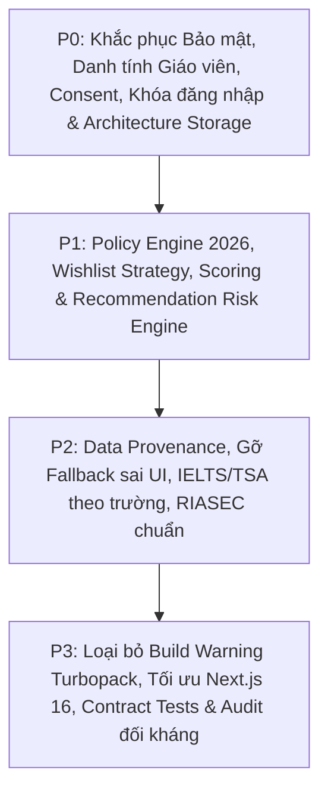

# BÁO CÁO KHẢO SÁT VÀ BASELINE HỆ THỐNG TROVIO
> **Ngày thực hiện**: 2026-10-11  
> **Múi giờ**: Asia/Saigon  
> **Thời điểm nghiệp vụ**: Tuyển sinh Đại học 2026  
> **Cơ sở pháp lý trọng tâm**: Thông tư số 06/2026/TT-BGDĐT của Bộ Giáo dục và Đào tạo (ban hành & hiệu lực từ 15/02/2026)  
> **Next.js Version**: 16.3.6 (Turbopack, App Router, React 19)

---

## 1. KẾT QUẢ KIỂM TRA BASELINE (TRƯỚC KHI SỬA)

Hệ thống được chạy kiểm tra trên mã nguồn hiện trạng:

| Lệnh kiểm tra | Kết quả | Chi tiết / Cảnh báo |
| :--- | :--- | :--- |
| `npm test` | **97 passed / 0 failed** | Thời gian chạy ~3.3s. 97 unit tests đạt. |
| `npm run typecheck` | **Passed (Exit code 0)** | TypeScript 5.6.0 không có lỗi kiểu tĩnh. |
| `npm run build` | **Build thành công (108/108 trang)** | **Cảnh báo Turbopack**: `Dynamic filesystem access causes tracing of the whole project` tại `./database/repositories/json-file.ts:246:18` do gọi `stat(file)`. Toàn bộ dự án bị trace vào production output. |

---

## 2. BẢNG PHÂN LOẠI TOÀN DIỆN CÁC VẤN ĐỀ TRỌNG YẾU

### 2.1. Mức P0: Sai nghiệp vụ cốt lõi / Lỗ hổng bảo mật / Quyền riêng tư & Rò rỉ dữ liệu

1. **Người dùng tự gán role `teacher` và tạo lớp trái phép (`auth.service.ts` line 285)**:
   - Bất kỳ tài khoản nào gọi `updateProfile({ role: "teacher" })` đều trở thành giáo viên mà không cần nộp hồ sơ, minh chứng hay kiểm duyệt từ trường/quản trị.
   - Sau đó tạo được lớp học, cấp mã lớp và xem tiến độ học sinh.
2. **Học sinh thiếu cơ chế chấp thuận phân quyền (Granular Consent) & Thu hồi (Revocation) (`class.service.ts`)**:
   - Học sinh nhập mã lớp thì mặc định chia sẻ toàn bộ dữ liệu (RIASEC, điểm, số nguyện vọng).
   - Chưa có quyền đồng ý theo từng phạm vi (tên, tiến độ, RIASEC, nguyện vọng, tư vấn) và chưa có chức năng thu hồi consent có hiệu lực tức thì.
3. **Thiếu Audit Log khi giáo viên truy cập dữ liệu nhạy cảm của học sinh (`class.service.ts` line 105 `dashboard`)**:
   - Giáo viên đọc `userData` của toàn bộ học sinh trong lớp nhưng không lưu nhật ký kiểm toán (ai đã xem, lúc nào, xem những gì).
4. **Khóa tài khoản vĩnh viễn sau 5 lần đăng nhập sai (`auth.service.ts` line 106-107)**:
   - Ghi cứng `locked = true` vĩnh viễn, không có exponential backoff, không có thời điểm tự mở khóa (lockout duration / unlockAt), dẫn đến nguy cơ DoS tài khoản người dùng hàng loạt.
5. **Tiết lộ sự tồn tại của tài khoản (Account Enumeration) (`auth.service.ts` line 100)**:
   - Email không tồn tại trả về `attemptsLeft: 5`, email có thật nhưng sai mật khẩu trả về số lần giảm dần (4, 3, 2, 1). Kẻ tấn công dễ dàng dò quét email hợp lệ.
6. **Mã lớp học không có thời hạn & không có cơ chế thu hồi (`class.service.ts` line 28, 72)**:
   - Mã lớp 6 ký tự cố định mãi mãi, không có ngày hết hạn, không có khả năng revoke mã và không có rate limit chống brute-force mã lớp.
7. **Production chưa dùng PostgreSQL thực tế làm Source of Truth (`database/repositories/index.ts`)**:
   - `repositories` map toàn bộ dữ liệu người dùng, điểm, tài khoản, lớp học sang `json-file.ts`.
   - `database/client.ts` nuốt lỗi `catch { return []; }`, production âm thầm chạy trên file JSON hoặc fail không an toàn.
   - Side effect khi import: `postgres.ts` tự động chạy `setTimeout(refreshPostgresCache)` khi import module, vi phạm tính độc lập và sạch của Data Access Layer.

### 2.2. Mức P1: Sai quyết định tuyển sinh & Quy tắc pháp lý 2026

1. **Giới hạn số lượng nguyện vọng sai (Hard-code 50 thay vì 15) (`user-data.service.ts` line 11 `MAX_WISHLIST = 50`)**:
   - Thông tư 06/2026/TT-BGDĐT quy định thí sinh được đăng ký **tối đa 15 nguyện vọng**. Hệ thống cho phép lưu tới 50 nguyện vọng.
2. **Cưỡng ép sắp xếp nguyện vọng từ khó xuống dễ (`wishlist-strategy.ts` line 125-136)**:
   - Hệ thống phán rằng "Thứ tự chưa hợp lý: NV sau khó hơn NV trước thì sẽ không bao giờ được xét", và tự ý sắp xếp lại theo độ khó (`b.rank - a.rank`).
   - Đây là sai lầm nghiêm trọng về cơ chế xét tuyển: Thí sinh đăng ký theo **mức độ mong muốn thực tế**. Một nguyện vọng khó hơn ở vị trí sau hoàn toàn hợp lệ nếu đó là sở thích thật, và nếu trượt nguyện vọng trước thì nguyện vọng sau vẫn được xét bình thường.
3. **Thiếu quy định riêng cho ngành đào tạo giáo viên (Sư phạm)**:
   - Theo Thông tư 06/2026/TT-BGDĐT, ngành đào tạo giáo viên chỉ được đặt ở thứ tự ưu tiên từ **nguyện vọng 01 đến 05**. Hệ thống chưa có kiểm tra ràng buộc này.
4. **Sai mã đối tượng ưu tiên 2026 (`scoring.service.ts` line 92-93)**:
   - Code đang ghi: UT1 là đối tượng 01–04, UT2 là đối tượng 05–07.
   - Chuẩn theo Thông tư 06/2026/TT-BGDĐT: UT1 là đối tượng 01–03 (+2.0 điểm); UT2 là đối tượng 04–06 (+1.0 điểm).
5. **Phương thức xét học bạ chưa đáp ứng điều kiện 2026**:
   - Quy chế 2026: Xét học bạ dùng điểm 6 học kỳ (lớp 10, 11, 12), tổ hợp ít nhất 3 môn, bắt buộc có môn Toán hoặc Ngữ văn, và môn Toán hoặc Ngữ văn phải chiếm tối thiểu 1/3 trọng số (thang 30).
6. **Ngưỡng đầu vào thi THPT tối thiểu 15/30**:
   - Quy chế 2026 yêu cầu ngưỡng đảm bảo chất lượng tối thiểu 15/30 điểm (không tính điểm ưu tiên) cho thí sinh xét tuyển.
7. **Quy đổi IELTS dùng một bảng toàn cục cho mọi trường (`scoring.service.ts` line 33)**:
   - Mỗi trường, mỗi ngành, mỗi phương thức có quy định quy đổi hoặc điểm cộng chứng chỉ ngoại ngữ khác nhau. Dùng bảng global áp đặt là sai thực tế.
8. **Kỳ thi TSA (ĐH Bách Khoa) chưa được hỗ trợ nhất quán**:
   - Dù có key `tsa` nhưng chưa có dữ liệu chính thức, thiếu trong các quy tắc quy đổi, UI chưa hiển thị rõ trạng thái thiếu dữ liệu.
9. **Thuật toán gợi ý trừ điểm "An toàn" so với "Vừa sức" (`recommendation.service.ts` line 85)**:
   - `FIT_POINTS: { "vua-suc": 100, "an-toan": 80, "thu-suc": 40 }`: Gán An toàn 80 điểm làm cho một ngành hoàn toàn an toàn lại có điểm đề xuất thấp hơn ngành vừa sức.
   - Chưa tách bạch giữa độ phù hợp sở thích (Fit/Interest) và xác suất trúng tuyển (Admission Risk).
   - Thiếu chỉ số tin cậy (Confidence Score) dựa trên số năm dữ liệu và tỷ lệ dữ liệu chính thức vs ước tính.

### 2.3. Mức P2: Chất lượng dữ liệu / Provenance / Fallback UI gây hiểu nhầm

1. **Hiển thị "Xét học bạ" hoặc "Xét học bạ / IELTS" khi thiếu điểm chuẩn**:
   - Xuất hiện tại: `chuong-trinh/[slug]`, `nganh/[slug]`, `compare-view.tsx`, `program-card.tsx`, `nhe/page.tsx`, `saved-view.tsx`, `chatbot.service.ts`.
   - Một chương trình chưa có dữ liệu điểm chuẩn bị biến thành "Xét học bạ", gây ngộ nhận cho thí sinh. Phải hiển thị "Chưa có dữ liệu chính thức".
2. **Thiếu Data Provenance theo từng trường dữ liệu**:
   - 247 chương trình hầu hết có `sourceUrl: null` và `source: "Dữ liệu tổng hợp 2025/2026"`.
   - Chưa phân biệt rõ `sourceType` (official, estimated, demo), thiếu ngày kiểm chứng, tài liệu gốc, mùa tuyển sinh hiệu lực.
3. **RIASEC gọi heuristic là "Iachan" và hiển thị độ chính xác 98% (`riasec-match.ts`)**:
   - Công thức hiện tại chỉ là khoảng cách lục giác kết hợp phần trăm, chưa phải Iachan Agreement Index chuẩn quốc tế.
   - Giới hạn cứng `Math.min(98, finalScore)` tạo ảo giác độ chính xác khoa học.
   - Thiếu schema validation chặt chẽ cho câu trả lời quiz ở server boundary.

### 2.4. Mức P3: Tối ưu hóa, Cấu trúc dữ liệu & Nợ kỹ thuật

1. **Turbopack Build Warning**: `stat(file)` trong `json-file.ts` gây trace toàn bộ dự án vào build output.
2. **Rate Limiting bộ nhớ đơn tiến trình**: Chưa hỗ trợ distributed/shared store trong production khi mở rộng nhiều instance.
3. **Tài liệu phân tán và thiếu đồng bộ**: Nhiều file doc ghi nhận mâu thuẫn giữa trạng thái đang làm và đã làm.

---

## 3. LỘ TRÌNH VÀ KẾ HOẠCH HÀNH ĐỘNG THEO THỨ TỰ ƯU TIÊN

Kế hoạch triển khai lần lượt qua các Giai đoạn từ 1 đến 14 với mục tiêu vượt qua toàn bộ Quality Gates: `npm test`, `npm run typecheck`, `npm run build` không còn cảnh báo tracing, và kiểm toán đối kháng 100% đạt chuẩn.
