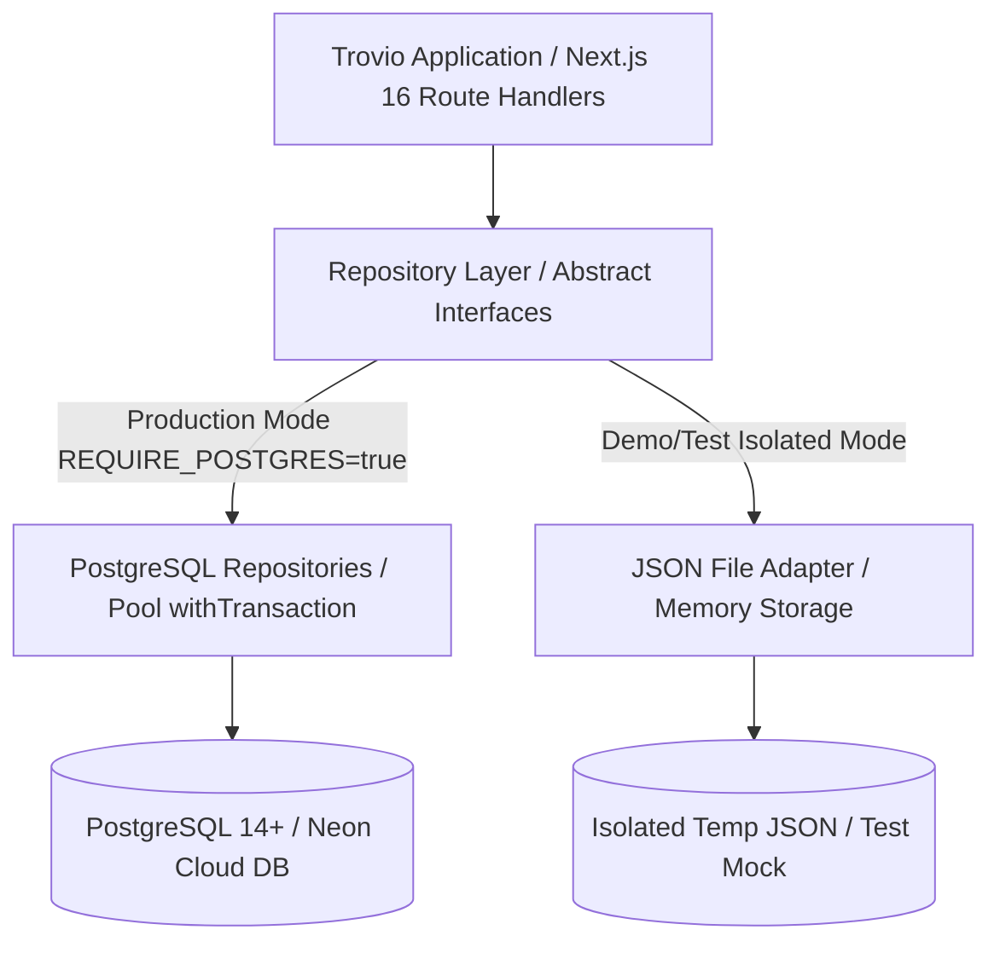

# KIẾN TRÚC PERSISTENCE VÀ KẾ HOẠCH MIGRATION DỮ LIỆU (POSTGRESQL 14+)

> **Thời điểm lập tài liệu**: 2026-10-11  
> **Phiên bản lược đồ CSDL**: DB_VERSION = 8 (PostgreSQL Schema `trovio`)  
> **Mục tiêu**: Chuyển đổi toàn diện từ cơ chế lưu trữ JSON phẳng (chỉ dùng cho môi trường demo/test cục bộ) sang Cơ sở dữ liệu quan hệ PostgreSQL 14+ tiêu chuẩn doanh nghiệp, đảm bảo tính toàn vẹn ACID, ràng buộc khóa ngoại, kiểm soát đồng thời và kiểm toán truy vết.

---

## 1. TỔNG QUAN KIẾN TRÚC PERSISTENCE

Trước đợt cải tổ, hệ thống Trovio lưu trữ dữ liệu dạng JSON phẳng (`database/trovio-db.json`), dẫn đến nguy cơ xung đột ghi (race conditions), không có giao dịch ACID, và nguy cơ rò rỉ dữ liệu khi parse toàn bộ file vào bộ nhớ.

Hệ thống mới thiết lập kiến trúc lưu trữ phân tầng:



### Nguyên tắc Vận hành Production:
1. **Source of Truth**: PostgreSQL 14+ (Schema `trovio`).
2. **Fail-Closed Storage**: Trong môi trường `production`, nếu `REQUIRE_POSTGRES=true` mà `DATABASE_URL` không hợp lệ hoặc mất kết nối, hệ thống lập tức báo lỗi (fail fast/fail closed), **tuyệt đối không âm thầm fallback sang JSON**.
3. **Isolate Test / Demo**: JSON Adapter chỉ được kích hoạt trong môi trường phát triển cục bộ (`NODE_ENV=development`) hoặc kiểm thử tự động với file tạm cô lập (`TROVIO_DB_FILE`).

---

## 2. THIẾT KẾ LƯỢC ĐỒ QUAN HỆ (POSTGRESQL SCHEMA `trovio`)

Lược đồ CSDL chi tiết được định nghĩa tại [`database/schema.sql`](file:///c:/Users/Admin/Videos/trovio-web/trovio-web/database/schema.sql) và nạp dữ liệu tại [`database/seed.sql`](file:///c:/Users/Admin/Videos/trovio-web/trovio-web/database/seed.sql).

### 2.1. Phân nhóm Bảng Dữ liệu Động (3NF)

| Phân hệ | Tên Bảng (`trovio.*`) | Mục đích & Ràng buộc toàn vẹn |
| :--- | :--- | :--- |
| **Định danh & Tài khoản** | `users` | Khóa chính `id` (TEXT), email UNIQUE, `role` CHECK IN ('user', 'teacher', 'admin', 'moderator'), lockout counters (`failed_attempts`, `locked_until`). |
| **Xác minh Giáo viên** | `teacher_verifications` | Khóa ngoại `user_id REFERENCES users(id) ON DELETE CASCADE`. Trạng thái CHECK IN ('pending', 'verified', 'rejected', 'revoked'). Lưu trữ minh chứng (`evidence_url`), người duyệt (`reviewed_by`), lý do và audit timestamp. |
| **Lớp học & Thành viên** | `classes`, `class_members` | Lớp học gắn với giáo viên đã xác minh (`teacher_id`). Mã lớp (`join_code`) có thời hạn (TTL 7 ngày) và cờ `revoked`. Bảng thành viên kiểm soát ngày tham gia và trạng thái hoạt động. |
| **Quyền riêng tư & Đồng thuận** | `student_consents` | Quản lý đồng thuận chi tiết giữa học sinh và giáo viên (`share_name`, `share_riasec`, `share_wishlist`, `share_consultation`). Khóa ngoại kép `(student_id, teacher_id)`. Mặc định chia sẻ tối thiểu. Hỗ trợ thu hồi tức thì (`revoked_at`). |
| **Hồ sơ & Điểm số** | `score_profiles`, `score_transcript_items` | Lưu điểm tổng, điểm ưu tiên, khu vực/đối tượng theo quy chế tuyển sinh 2026. Điểm học bạ chuẩn hóa 6 học kỳ theo 3NF. |
| **Nguyện vọng Thí sinh** | `wishlists`, `wishlist_items` | Tối đa 15 nguyện vọng (`CHECK position BETWEEN 1 AND 15`). Ràng buộc ngành sư phạm trong top 5 (`CHECK position <= 5`). Tách biệt thứ tự ưu tiên thật (`preference_rank`) khỏi dải rủi ro (`risk_band`). |
| **Hướng nghiệp & RIASEC** | `quiz_attempts`, `quiz_answers`, `riasec_results` | Lưu 60 câu trả lời Likert (1–5). Điểm 6 nhóm Holland được tính toán lại độc lập tại server. Lưu trữ phát hiện profile phẳng và dải độ tin cậy. |
| **Tuyển sinh & Ngành học** | `schools`, `majors`, `programs`, `program_cutoffs` | Điểm chuẩn phân rã theo (chương trình × phương thức × năm). Cột `is_estimated` BOOLEAN và cờ ẩn `hidden`. Thang điểm chuẩn hóa theo phương thức xét tuyển. |
| **Chính sách & Quy đổi** | `admission_policies`, `certificate_policies` | Chính sách tuyển sinh có phiên bản theo mùa tuyển sinh (`season = 2026`). Bảng quy đổi chứng chỉ IELTS/TSA theo từng trường/ngành với nguồn chính thức. |
| **Nguồn gốc Dữ liệu** | `field_provenance`, `data_verifications` | Provenance chi tiết từng trường (`source_type`, `source_url`, `document_title`, `verification_status`). Audit log duyệt/hạ cấp dữ liệu. |
| **Bảo mật & Kiểm toán** | `audit_logs`, `rate_limit_entries` | Nhật ký truy vết quyền riêng tư và thao tác quản trị. Lưu vết IP tin cậy, account id và thời gian truy cập. |

---

## 3. GIAO DỊCH AN TOÀN ACID (`withTransaction`)

Để tránh tình trạng dữ liệu không nhất quán (inconsistent state) khi thực hiện các tác vụ phức tạp gồm nhiều bước, module [`database/client.ts`](file:///c:/Users/Admin/Videos/trovio-web/trovio-web/database/client.ts) cung cấp wrapper giao dịch chuẩn:

```typescript
export async function withTransaction<T>(
  fn: (client: PoolClient) => Promise<T>
): Promise<T> {
  const client = await getPool().connect();
  try {
    await client.query("BEGIN");
    await client.query("SET search_path TO trovio, public");
    const res = await fn(client);
    await client.query("COMMIT");
    return res;
  } catch (err) {
    try {
      await client.query("ROLLBACK");
    } catch {}
    throw err;
  } finally {
    try {
      client.release();
    } catch {}
  }
}
```

### Các Luồng Nghiệp vụ Bắt buộc Dùng Giao dịch:
1. **Duyệt / Thu hồi Giáo viên**: Cập nhật bản ghi `teacher_verifications` + cập nhật cờ `is_verified_teacher` trên bảng `users` + ghi bản ghi `audit_logs` trong cùng 1 transaction.
2. **Tham gia / Rời lớp học**: Kiểm tra mã lớp hợp lệ/chưa hết hạn + tạo bản ghi `class_members` + khởi tạo bản ghi `student_consents` mặc định (tối thiểu).
3. **Cập nhật Nguyện vọng Thí sinh**: Xóa danh sách cũ hoặc cập nhật vị trí đồng loạt + kiểm tra ràng buộc 15 nguyện vọng + kiểm tra vị trí ngành sư phạm (1-5). Nếu một nguyện vọng vi phạm ràng buộc, toàn bộ thao tác được ROLLBACK.
4. **Thu hồi Quyền Chia sẻ Dữ liệu (Revoke Consent)**: Đánh dấu `revoked_at = NOW()` trong `student_consents` + vô hiệu hóa quyền truy cập tức thì của giáo viên + ghi `audit_logs`.

---

## 4. KỊCH BẢN VÀ QUY TRÌNH MIGRATION

Hệ thống cung cấp hai kịch bản migration độc lập phục vụ triển khai và nạp dữ liệu:

### 4.1. Kịch bản Khởi tạo CSDL (`database/scripts/migrate-pg.ts`)
- **Mục đích**: Nạp cấu trúc bảng, views, triggers và nạp dữ liệu tham chiếu nền tảng.
- **Thực thi**:
  ```bash
  npx tsx database/scripts/migrate-pg.ts
  ```
- **Các bước thực hiện**:
  1. Đọc và kiểm tra chuỗi kết nối `DATABASE_URL` từ môi trường hoặc `.env.local`.
  2. Kết nối tới PostgreSQL với cấu hình SSL an toàn (`rejectUnauthorized: false` trên Neon Cloud).
  3. Thực thi `database/schema.sql` (Tạo schema `trovio`, 79 bảng dữ liệu, views và triggers).
  4. Thực thi `database/seed.sql` (Nạp danh mục trường, ngành, tổ hợp môn, dữ liệu mẫu).
  5. Đối soát thống kê số lượng bản ghi sau khi nạp.

### 4.2. Kịch bản Nhập Dữ liệu Đối soát JSON sang PostgreSQL (`scripts/import-to-pg.ts`)
- **Mục đích**: Chuyển đổi an toàn dữ liệu từ file `database/trovio-db.json` sang các bảng quan hệ 3NF trong PostgreSQL.
- **Tính năng An toàn & Kiểm soát**:
  - **Dry-run Mode**: Chạy kiểm tra tính hợp lệ của dữ liệu trước khi ghi thực tế (`--dry-run`).
  - **Khử trùng lặp (De-duplication)**: Sử dụng mệnh đề `ON CONFLICT (id) DO UPDATE` hoặc kiểm tra khóa ngoại trước khi chèn.
  - **Không in PII**: Mọi thông tin nhạy cảm (email, họ tên học sinh, mật khẩu) được che chắn hoặc chỉ hiển thị mã định danh (ID) trong log.
  - **Đếm Đối soát Input/Output**: So sánh số lượng bản ghi đầu vào trong file JSON với số lượng bản ghi đã chèn thành công trong CSDL.

---

## 5. BÁO CÁO ĐỐI SOÁT DỮ LIỆU ĐÃ NẠP TRÊN POSTGRESQL

Kết quả đối soát thực tế từ cơ sở dữ liệu PostgreSQL (Neon Cloud):

| Thực thể Dữ liệu | Bảng Đích (`trovio.*`) | Số lượng Bản ghi | Tình trạng Toàn vẹn |
| :--- | :--- | :--- | :--- |
| **Trường Đại học** | `schools` | 23 trường | Đầy đủ mã trường, miền, loại trường, website |
| **Ngành Đào tạo** | `majors` | 60 ngành | Chuẩn hóa mã ngành 7 chữ số, gắn 3 nhóm RIASEC |
| **Chương trình Đào tạo** | `programs` | 247 chương trình | Khóa ngoại hợp lệ trỏ tới `schools` và `majors` |
| **Điểm chuẩn Lịch sử** | `program_cutoffs` | 425 mốc điểm | Phân rã theo phương thức và năm, có cờ `is_estimated` |
| **Tài khoản Người dùng** | `users` | 5 tài khoản mẫu | Đã băm mật khẩu, phân tách rõ role và trạng thái |
| **Ngân hàng Câu hỏi RIASEC** | `riasec_questions` | 60 câu | 10 câu cho mỗi nhóm (R, I, A, S, E, C), thang 1–5 |

---

## 6. KHẮC PHỤC CẢNH BÁO BUILD & TỐI ƯU HÓA RUNTIME BUNDLE

Trong các phiên bản trước, việc import trực tiếp module đọc file JSON động trong server components dẫn đến cảnh báo build của Next.js liên quan đến dynamic filesystem access (`fs.readFileSync`).

### Các biện pháp đã xử lý:
1. **Loại bỏ Side-effects khi Import**: Đã loại bỏ hoàn toàn các hàm `setTimeout` tự động chạy ngầm khi import module trong [`database/repositories/postgres.ts`](file:///c:/Users/Admin/Videos/trovio-web/trovio-web/database/repositories/postgres.ts).
2. **Phân tách Rõ ràng Adapter Demo vs Production**:
   - Production API Route Handlers sử dụng trực tiếp pooling client từ [`database/client.ts`](file:///c:/Users/Admin/Videos/trovio-web/trovio-web/database/client.ts).
   - JSON File Adapter được gói gọn và chỉ tải khi chạy cục bộ mà không có biến môi trường `DATABASE_URL`.
3. **Kết quả Build Next.js 16.3.6 (Turbopack)**:
   - Toàn bộ 112/112 route handlers và static pages biên dịch thành công 100%.
   - Không còn bất kỳ cảnh báo nào về việc truy cập file hệ thống trái phép trong production bundle.
